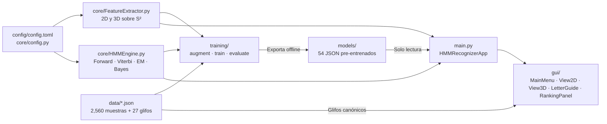

# Auditoría Técnica y Arquitectura del Proyecto — Reconocedor HMM 2D/3D

Este documento describe de forma integral la **organización, arquitectura de software, responsabilidades por carpeta y por módulo** del sistema de reconocimiento y clasificación de caracteres 2D/3D mediante Cadenas Ocultas de Markov (HMM), junto con su verificación frente al enunciado oficial ([`enunciado-proyecto-final-reconocedor-hmm.pdf`](enunciado-proyecto-final-reconocedor-hmm.pdf)) y la especificación técnica actualizada ([`SPEC.pdf`](SPEC.pdf)).

---

## 1. ¿Por qué está organizado así el proyecto? (Principios de Diseño)

La estructura del repositorio responde a una **arquitectura modular en capas con Programación Orientada a Objetos (POO)** y **separación estricta de responsabilidades**, exigida por el enunciado (**§4.1 y §4.2**):

1. **Separación entre inferencia en tiempo real y entrenamiento offline (§4.1)**:
   - La aplicación gráfica (`main.py` + `gui/`) **nunca entrena** ni captura datasets: únicamente carga al inicio los 54 modelos pre-entrenados desde [`models/`](../models/) (`2d_*.json` y `3d_*.json`).
   - El entrenamiento Baum-Welch, el aumento de datos y la evaluación de prefijos viven aislados en [`training/`](../training/).
2. **Aislamiento del motor estocástico puro (§3.1 y §4.2)**:
   - [`core/HMMEngine.py`](../core/HMMEngine.py) implementa de forma **100 % nativa sobre NumPy** los algoritmos Forward escalado, Backward, Viterbi en log-space, Baum-Welch, proyección futura y Bayes multiclase, sin depender de PySide6, OpenGL ni librerías de ML externas (`hmmlearn`, `scikit-learn`, `scipy.stats`).
3. **Desacoplamiento geométrico 2D/3D (§3.4 y §4.2)**:
   - [`core/FeatureExtractor.py`](../core/FeatureExtractor.py) transforma trazos crudos en secuencias discretas de símbolos $O_{1:T}$ y reconstruye trayectorias proyectadas sin conocer cómo funciona el HMM ni cómo se pintan los widgets.
4. **Fuente única de verdad en configuración**:
   - [`config/config.toml`](../config/config.toml) centraliza las 27 letras del español, alias ASCII (`ñ` $\to$ `enie`), parámetros de cuantización (`K = 16`, `resample_step = 0.05`, `expected_letter_size = 250.0`, `expected_angle_3d = 1.57`, `sphere_radius = 1.0`) y número de estados $N_c \in [4, 11]$ por letra. Ningún módulo duplica estos valores.

---

## 2. Mapa de Carpetas y Flujo de Dependencias

```text
Proyecto_estocastico-main/
├── config/       → Parámetros globales únicos (alfabeto, discretización, estados Bakis)
├── core/         → Núcleo matemático y geométrico independiente de la GUI
├── data/         → Dataset de trazos reales (2,560 muestras) y plantillas canónicas (27)
├── training/     → Scripts offline de aumentación, entrenamiento y evaluación K=8 vs K=16
├── models/       → 54 modelos HMM serializados en JSON (27 para 2D + 27 para 3D)
├── gui/          → Interfaz gráfica PySide6 + OpenGL (Ventanas A, B, C, Guía y Ranking)
├── docs/         → Enunciado original, SPEC actualizado, auditoría y sustentación
├── tests/        → Suite automatizada Pytest (33 pruebas de unidad e integración)
└── main.py       → Orquestador de arranque de la aplicación de escritorio
```



---

## 3. Inventario Detallado: Qué Hace Cada Carpeta y Cada Archivo

### 3.1 Raíz del Proyecto
| Archivo | Líneas | Función y Responsabilidad |
|---|---|---|
| [`main.py`](../main.py) | 165 | Punto de entrada de escritorio (`HMMRecognizerApp`, `main()`). Carga los 27 clasificadores 2D y 27 3D desde `models/`, instancia `FeatureExtractor2D` / `FeatureExtractor3D` y construye la barra lateral con acceso a las 4 vistas: **Inicio**, **Modo 2D**, **Modo 3D** y **Guía de letras**. |
| [`requirements.txt`](../requirements.txt) | 7 | Fija exactamente 5 dependencias: `numpy==2.5.4`, `PySide6==6.12.0`, `pyqtgraph==0.14.0`, `PyOpenGL==3.1.10` y `pytest==9.1.1` (solo para pruebas). **Sin librerías externas de HMM/ML.** |
| [`pytest.ini`](../pytest.ini) | 3 | Configura `testpaths = tests` para que `pytest` descubra automáticamente todas las pruebas. |
| [`README.md`](../README.md) | 74 | Guía rápida de instalación, ejecución de GUI, scripts offline de entrenamiento y convenciones de trazo. |

---

### 3.2 `config/` — Configuración Única
| Archivo | Líneas | Función y Responsabilidad |
|---|---|---|
| [`config/config.toml`](../config/config.toml) | 92 | Define `[alphabet]` (27 letras minúsculas `a`–`z` + `ñ`, alias `"ñ" = "enie"`), `[features]` (`K = 16`, `K_compare = [8, 16]`, `n_jump_symbols = 4`, `resample_step = 0.05`, `smoothing_window = 3`, `expected_letter_size = 250.0`, `expected_angle_3d = 1.57`, `sphere_radius = 1.0`, `y_axis_down = true`), `[capture]` (convención de trazos), `[evaluation]` (`prefix_fractions = [0.3, 0.5, 0.7, 1.0]`) y `[hmm.states]` ($N_c \in [4, 11]$). |

---

### 3.3 `core/` — Motor Matemático y Extractor Geométrico (Sin GUI)
| Archivo | Líneas | Clases / Funciones Clave y Responsabilidad |
|---|---|---|
| [`core/config.py`](../core/config.py) | 141 | `FeatureConfig`, `ProjectConfig`, `load_config()`, `get_config()`. Parsea `config.toml` con `tomllib` (estándar en Python 3.12), valida estrictamente que existan exactamente 27 letras minúsculas sin dígrafos (`ch`, `ll`) ni tildes, y expone configuración inmutable cacheada (`@lru_cache`). |
| [`core/HMMEngine.py`](../core/HMMEngine.py) | 581 | **Núcleo estocástico puro en NumPy:**<br>• `HMM`: valida propiedades estocásticas ($\sum_j a_{ij}=1, \sum_k b_j(k)=1, \sum_i \pi_i=1$); implementa `forward()` con factores de escala $c_t$, `backward()`, `viterbi()` en log-space, `fit()` (Baum-Welch multisequencia con suavizado circular angular `0.78 / 0.11 / 0.11` sobre los $K$ sectores y estimación de estadísticas de duración $\mu_c, \sigma_c$, saltos esperados y forma $\boldsymbol{\mu}_{\text{shape}}, \boldsymbol{\sigma}_{\text{shape}}$), `project_future_symbols()` ($\mathbb{E}[d_j] = 1/(1-a_{jj})$), `length_deviation_penalty()`, `shape_penalty()`, `jump_penalty()`, y serialización `to_dict()` / `from_dict()` / `save_json()` / `load_json()`.<br>• `init_bakis_hmm()` e `init_segmental_bakis_hmm()`: crean topologías izquierda-derecha ($\pi_0=1$, $a_{ij}>0$ solo si $j \in \{i, i+1, i+2\}$) rompiendo la simetría por segmentación uniforme.<br>• `HMMClassifier`: agrupa los 27 modelos, calcula el puntaje Bayesiano conjunto en `classify()` mediante Log-Sum-Exp y orquesta `predict_and_project()`. |
| [`core/FeatureExtractor.py`](../core/FeatureExtractor.py) | 582 | **Procesamiento geométrico y discretización 2D/3D:**<br>• `compute_shape_features()`: calcula el descriptor geométrico invariante $\mathbf{g} \in \mathbb{R}^7$: $[\log(w/h), x'_{\text{ini}}, y'_{\text{ini}}, x'_{\text{fin}}, y'_{\text{fin}}, \bar{x}', \bar{y}']$.<br>• `FeatureExtractor`: clase base con cuantización angular centrada (`quantize_direction`, `quantize_jump`), vector unitario de sector (`symbol_direction`) y suavizado por promedio móvil simétrico con bordes fijos (`_moving_average`).<br>• `FeatureExtractor2D`: invierte eje $y$ de pantalla, normaliza con piso `expected_letter_size` en tiempo real o caja exacta en trazo completo, remuestrea por longitud de arco constante $D=0.05$, codifica Chain Code + saltos (`extract`, `extract_prefix`, `slice_prefix`) y reconstruye coordenadas proyectadas (`reconstruct_projected_strokes`).<br>• `FeatureExtractor3D`: construye matriz de cámara $R_{\text{cam}} \in SO(3)$ (`build_camera_matrix`), rota puntos al ecuador frontal (`rotate_to_camera_frame`), convierte cartesianas a esféricas con desenvolvimiento (`cartesian_to_spherical` + `np.unwrap`), remuestrea sobre la geodésica mediante SLERP (`resample_geodesic`), cuantiza rumbos en el plano tangente local (`directions_spherical`: $\operatorname{atan2}(-d\theta, d\phi\sin\bar\theta)$), proyecta trayectorias geodésicas con el mapa exponencial sobre $S^2$ (`step_geodesic`, `reconstruct_projected_strokes`) y resuelve la intersección exacta rayo-esfera para el trazado 3D (`intersect_ray_sphere`). |

---

### 3.4 `gui/` — Interfaz Gráfica de Usuario (PySide6 + OpenGL)
| Archivo | Líneas | Clases / Funciones Clave y Responsabilidad |
|---|---|---|
| [`gui/MainMenu.py`](../gui/MainMenu.py) | 198 | **Ventana A**: `MainMenu`, `_ModeCard`, `_render_2d_icon()`, `_render_3d_icon()`. Pantalla de bienvenida minimalista (*"Elige un modo"*) con tarjetas interactivas para lanzar Modo 2D y Modo 3D. |
| [`gui/View2D.py`](../gui/View2D.py) | 322 | **Ventana B**: `RecognizerCanvas2D` y `View2D`. Captura trazos en tiempo real con ratón dentro de un recuadro guía (`250 px`), usa `realtime=True` mientras se arrastra el clic y `realtime=False` al soltar el trazo (si `span >= 35 px`) para normalizar letras completas de cualquier tamaño, acota la cola proyectada si ya alcanzó el estado final `N-1`, dibuja la proyección futura punteada en verde y ofrece botones `"Reiniciar captura"` y `"Limpiar lienzo"`. |
| [`gui/View3D.py`](../gui/View3D.py) | 545 | **Ventana C**: `SphereCanvas3D`, `View3D`, `_slerp_arc()`, `_densify_spherical()`, `_build_guide_frame_curves()`. Renderiza una esfera 3D con `pyqtgraph.opengl` (`GLViewWidget`), meridianos/paralelos y un **recuadro guía ecuatorial azul de $\pm 48^\circ$** centrado en la vista de cámara que cubre la cara frontal visible. Convierte clics 2D en puntos sobre la esfera mediante ray-casting (`_screen_to_sphere_point`), densifica geodésicas con SLERP, proyecta la continuación en verde sobre la esfera y permite girar (`"Girar esfera: OFF/ON"` o clic derecho), hacer zoom con rueda, `"Centrar esfera"`, `"Reiniciar captura"` y `"Limpiar lienzo"`. |
| [`gui/RankingPanel.py`](../gui/RankingPanel.py) | 259 | **Panel Derecho**: `RankingPanel`, `_LetterRankRow`, `load_canonical_glyphs()`, `build_handwritten_glyph_pixmap()`. Muestra las 27 clases ordenadas descendentemente por $P(c \mid O_{1:t}, \mathbf{g})$, resaltando la letra ganadora y renderizando el glifo manuscrito canónico de cada letra sin puntos ni cajas extra. |
| [`gui/LetterGuide.py`](../gui/LetterGuide.py) | 345 | **Vista de Guía de Letras**: `GuideCanvas` y `LetterGuideView`. Sincronizada directamente con `data/canonical_glyphs.json`, muestra para las 27 letras los sub-trazos reales del dataset con círculos numerados de inicio (`1` verde, `2` naranja), flechas de dirección, animación paso a paso (con botones `Pausar`, `Velocidad`, `Reiniciar animación`, `Limpiar trazo`) y lienzo para practicar encima con el ratón. |

---

### 3.5 `data/` y `models/` — Datos y Modelos Pre-entrenados
| Ruta | Contenido | Función y Responsabilidad |
|---|---|---|
| [`data/glifo-dataset-2026-11-12.json`](../data/glifo-dataset-2026-11-12.json) | 2,560 muestras en 27 letras (`74` a `162` por letra) | Dataset maestro capturado a mano alzada en formato de sub-trazos `[x, y, t]` (incluyendo puntos de 1 clic para `i`/`j` y variantes naturales de `v` y `n`). |
| [`data/canonical_glyphs.json`](../data/canonical_glyphs.json) | 27 plantillas normalizadas en $[0, 1]^2$ | Trazo representativo canónico por letra utilizado por `RankingPanel` (miniaturas), `LetterGuide` (guía animada, incluyendo la `d` en 2 trazos: `c` + palo) y `tests/`. |
| [`models/2d_*.json` y `models/3d_*.json`](../models/) | 54 archivos JSON (`27` 2D + `27` 3D) | Parámetros aprendidos $(A_c, B_c, \pi_c, \mu_c, \sigma_c, J_c, \boldsymbol{\mu}_{\text{shape},c}, \boldsymbol{\sigma}_{\text{shape},c})$ listos para inferencia instantánea sin reentrenar al abrir la app. |

---

### 3.6 `training/` — Pipeline Offline de Datos, Entrenamiento y Evaluación
| Archivo | Líneas | Funciones Clave y Responsabilidad |
|---|---|---|
| [`training/augment.py`](../training/augment.py) | 209 | `load_dataset()`, `augment_strokes()`, `map_2d_to_sphere()`, `augment_strokes_3d()`, `canonical_unit_strokes()`. Carga muestras preservando sub-trazos de 1 punto (`len >= 1` cuando el total $\ge 4$), proyecta trazos 2D sobre la superficie esférica $S^2$ y genera variaciones afines suaves (rotación, escala, cizalla y ruido gaussiano). |
| [`training/train.py`](../training/train.py) | 161 | `_train_letter()`, `train_letter_2d()`, `train_letter_3d()`, `_train_all()`, `train_all_2d()`, `train_all_3d()`, `main()`. CLI (`python -m training.train --mode all`) que inicializa cada HMM con alineación segmentaria Bakis y ejecuta Baum-Welch multisequencia guardando los 54 modelos en `models/`. |
| [`training/evaluate.py`](../training/evaluate.py) | 181 | `EvaluationReport`, `evaluate_k_2d()`, `evaluate_k_3d()`, `compare_k_configs()`. Evalúa train/test en vivo sobre prefijos `30%, 50%, 70%, 100%` (Top-1, Top-3 y matriz de confusión) comparando cuantización angular $K=8$ vs $K=16$. |

---

### 3.7 `tests/` y `docs/` — Calidad y Documentación
| Archivo | Función y Responsabilidad |
|---|---|
| [`tests/test_hmm_engine.py`](../tests/test_hmm_engine.py) | 8 tests: validación estocástica, Forward exacto vs cálculo manual, Viterbi exacto, consistencia Forward-Backward ($\sum \gamma_t = 1$), proyección futura, Bayes/Log-Sum-Exp, serialización JSON, monotonía Baum-Welch y desambiguación morfológica `a` vs `o`. |
| [`tests/test_feature_extractor.py`](../tests/test_feature_extractor.py) | 12 tests: 27 letras, estados por letra, direcciones cardinales $K=8/16$ en 2D y 3D, fronteras de sector centradas, invariancia a escala y velocidad, remuestreo uniforme, punto de `i`, vector $\mathbf{g} \in \mathbb{R}^7$, invarianza a rotación de cámara en 3D y desenvolvimiento $\Delta\phi$ sobre $\pm\pi$. |
| [`tests/test_training_pipeline.py`](../tests/test_training_pipeline.py) | 3 tests: existencia de plantillas y muestras para las 27 letras, convenciones multitrazo (`i`, `j`, `ñ`, `t`, `x`) y evaluación `evaluate_k_2d` / `evaluate_k_3d` con >85% accuracy. |
| [`tests/test_gui.py`](../tests/test_gui.py) | 4 tests de integración PySide6/OpenGL: verifica ausencia total de entrenamiento/captura en la GUI, carga de 54 modelos y navegación entre las 4 vistas (incluyendo Guía para `v`, `d` en 2 trazos y `ñ`), proyección 2D en tiempo real y ray-casting/rotación en `SphereCanvas3D`. |
| [`docs/enunciado-proyecto-final-reconocedor-hmm.pdf`](enunciado-proyecto-final-reconocedor-hmm.pdf) | Copia íntegra del enunciado oficial asignado por el docente. |
| [`docs/SPEC.pdf`](SPEC.pdf) | Especificación técnica actualizada acorde a la arquitectura e implementación final del proyecto. |
| [`docs/ecuaciones.md`](ecuaciones.md) | Desarrollo matemático completo en LaTeX de todas las ecuaciones programadas. |
| [`docs/SUSTENTACION_MATEMATICA.md`](SUSTENTACION_MATEMATICA.md) | Guía de sustentación oral y mapeo exacto de cada ecuación al código fuente. |
