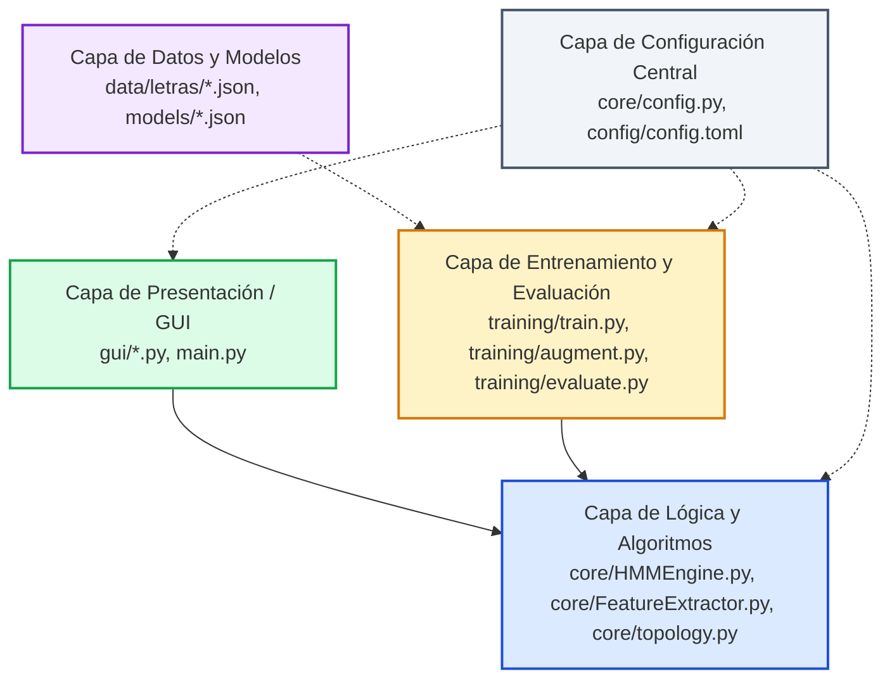
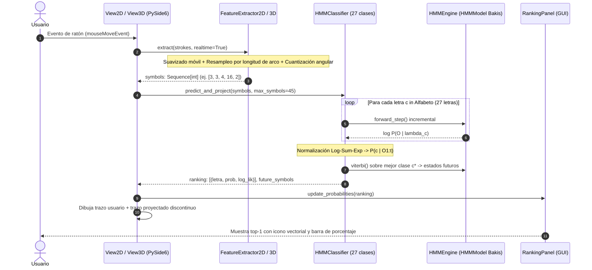
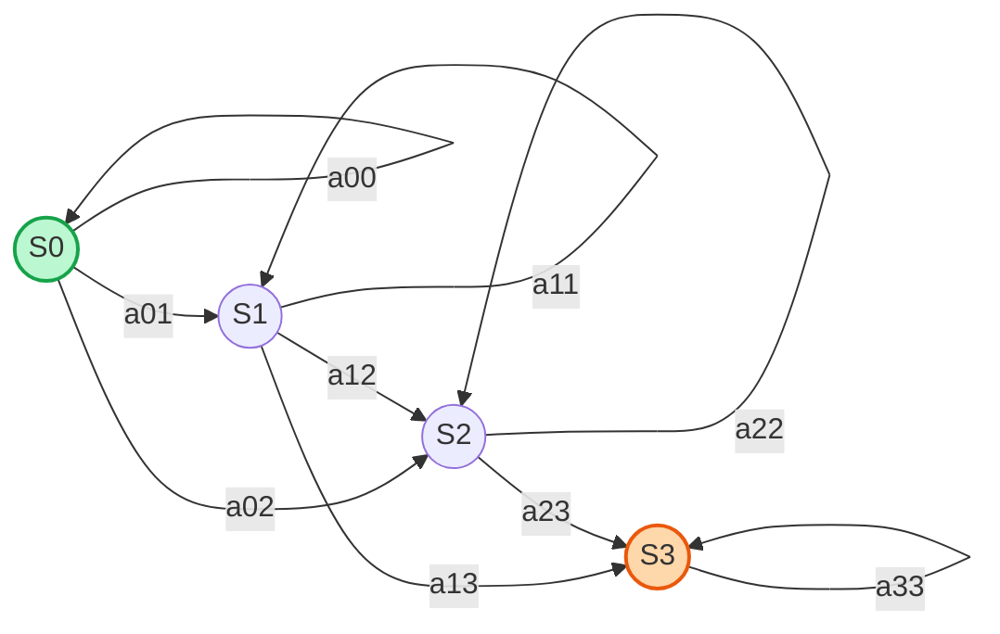

# Presentación Ejecutiva y Técnica del Proyecto
## Sistema de Reconocimiento de Caracteres Manuscritos 2D y 3D mediante Modelos Ocultos de Markov (*HMM*)

**Universidad de los Llanos**  
**Facultad de Ciencias Básicas e Ingeniería**  
**Asignatura:** Procesos Estocásticos  
**Autor:** Camilo Mendoza (`camilomendoza527-sketch`)  
**Repositorio GitHub:** [camilomendoza527-sketch/Proyecto_estocastico](https://github.com/camilomendoza527-sketch/Proyecto_estocastico)

---

## Índice de Contenidos

1. [Diapositiva 1: Portada y Ficha Técnica](#diapositiva-1-portada-y-ficha-técnica)
2. [Diapositiva 2: Resumen Ejecutivo y Objetivos](#diapositiva-2-resumen-ejecutivo-y-objetivos)
3. [Diapositiva 3: Arquitectura Limpia y Separación de Capas](#diapositiva-3-arquitectura-limpia-y-separación-de-capas)
4. [Diapositiva 4: Estructura del Proyecto y Contenido por Carpeta](#diapositiva-4-estructura-del-proyecto-y-contenido-por-carpeta)
5. [Diapositiva 5: Ubicación de Algoritmos y Notación Técnica](#diapositiva-5-ubicación-de-algoritmos-y-notación-técnica)
6. [Diapositiva 6: Arquitectura Lógica de los Módulos `.py`](#diapositiva-6-arquitectura-lógica-de-los-módulos-py)
7. [Diapositiva 7: Modelado Estocástico y Topología Bakis](#diapositiva-7-modelado-estocástico-y-topología-bakis)
8. [Diapositiva 8: Geometría Cartesiana 2D vs. Geometría Esférica 3D ($S^2$)](#diapositiva-8-geometría-cartesiana-2d-vs-geometría-esférica-3d-s2)
9. [Diapositiva 9: Pipeline de Entrenamiento y Dataset Manuscrito](#diapositiva-9-pipeline-de-entrenamiento-y-dataset-manuscrito)
10. [Diapositiva 10: Interfaz Gráfica y Guía Caligráfica Animada](#diapositiva-10-interfaz-gráfica-y-guía-caligráfica-animada)
11. [Diapositiva 11: Resultados Experimentales y Suite de Pruebas](#diapositiva-11-resultados-experimentales-y-suite-de-pruebas)

---

### Diapositiva 1: Portada y Ficha Técnica

```
========================================================================================
                      PROYECTO FINAL: PROCESOS ESTOCÁSTICOS
    RECONOCEDOR CONTINUO Y MULTICLASE DE TRAZOS MANUSCRITOS EN 2D Y 3D CON MODELOS HMM
========================================================================================
Institución: Universidad de los Llanos
Dominio:     Reconocimiento de patrones, cadenas de Markov, geometría diferencial esférica
Clases:      27 letras del alfabeto español (a..z, ñ) en 2D y 3D
Tecnologías: Python 3.12, NumPy, SciPy, PySide6 (Qt 6), pytest, TOML
========================================================================================
```

* **Problema:** Clasificar trazos manuscritos en tiempo real mientras el usuario escribe, soportando tanto el plano euclidiano $\mathbb{R}^2$ como la superficie de una esfera tridimensional $S^2 \subset \mathbb{R}^3$, proyectando además los trazos futuros más probables.
* **Solución Estocástica:** $27 \times 2 = 54$ Modelos Ocultos de Markov discretos independientes $\lambda_c = (A_c, B_c, \pi_c)$ bajo topología izquierda-derecha (*Bakis*).

---

### Diapositiva 2: Resumen Ejecutivo y Objetivos

> [!NOTE]
> **Objetivo General:** Diseñar, implementar y validar un reconocedor estocástico de caracteres manuscritos invariante a escala, velocidad de trazo y rotación de cámara, con evaluación continua de probabilidad posterior $P(c \mid O_{1:t})$ y proyección sintética del trazo faltante.

#### Capacidades Principales del Sistema:
1. **Doble Modalidad Espacial:**
   - **Modo 2D:** Captura en plano cartesiano normalizado con $K=16$ sectores angulares y $4$ direcciones cardinales de salto inter-trazo (*pen-up*).
   - **Modo 3D:** Captura interactiva sobre la esfera unitaria mediante *ray casting*, cálculo de rumbos ortodrómicos (*great-circle bearings*) y parametrización geodésica.
2. **Inferencia en Tiempo Real:** Cálculo continuo paso a paso con el algoritmo *Forward* escalado logarítmicamente ($O(N^2)$ por punto nuevo).
3. **Proyección Estocástica:** Inferencia del camino de estados óptimo mediante *Viterbi* y decodificación de las emisiones más probables de los estados futuros no observados.
4. **Guía Visual Caligráfica:** Demostración automática a 60 FPS con renglón escolar, punta de lápiz iluminada, flechas direccionales y numeración de sub-trazos.

---

### Diapositiva 3: Arquitectura Limpia y Separación de Capas

El software sigue estrictamente el patrón de **Arquitectura Limpia** (*Clean Architecture*), desacoplando totalmente las matemáticas de la interfaz gráfica y los datos:



* **Regla de Dependencia:** Ningún módulo de `core/` importa código de `gui/` ni de `training/`.
* **Determinismo:** Los algoritmos matriciales son funciones puras o métodos de clases autocontenidas basadas en *NumPy*.

---

### Diapositiva 4: Estructura del Proyecto y Contenido por Carpeta

A continuación se detalla la responsabilidad de cada directorio del repositorio:

| Directorio | Responsabilidad Técnica | Archivos Clave |
| :--- | :--- | :--- |
| [`core/`](file:///c:/Users/camil/Downloads/ProyectofinalEstocasticos/core) | **Núcleo algorítmico y estocástico puro.** Implementa los 5 algoritmos de HMM, la topología Bakis y la extracción geométrica 2D y 3D. | `HMMEngine.py`, `FeatureExtractor.py`, `topology.py`, `config.py` |
| [`gui/`](file:///c:/Users/camil/Downloads/ProyectofinalEstocasticos/gui) | **Capa de interfaz gráfica Qt (PySide6).** Lienzos de dibujo 2D/3D con OpenGL, panel lateral de probabilidades y guía caligráfica. | `MainMenu.py`, `View2D.py`, `View3D.py`, `RankingPanel.py`, `LetterGuide.py` |
| [`training/`](file:///c:/Users/camil/Downloads/ProyectofinalEstocasticos/training) | **Pipeline de entrenamiento y aumento sintético.** Generación de variaciones por rotación/ruido, ajuste Baum-Welch y validación cruzada. | `train.py`, `augment.py`, `evaluate.py` |
| [`data/`](file:///c:/Users/camil/Downloads/ProyectofinalEstocasticos/data) | **Datasets manuscritos y glifos canónicos.** Almacena las muestras humanas reales individuales y el dataset maestro. | `glifo-dataset-2026-11-06.json`, `letras/*.json` (27 archivos), `canonical_glyphs.json` |
| [`models/`](file:///c:/Users/camil/Downloads/ProyectofinalEstocasticos/models) | **Parámetros entrenados serializados en JSON.** 54 modelos (27 para 2D y 27 para 3D) con matrices $A$, $B$ y vector $\pi$. | `2d_a.json` ... `2d_z.json`, `3d_a.json` ... `3d_z.json` |
| [`config/`](file:///c:/Users/camil/Downloads/ProyectofinalEstocasticos/config) | **Configuración declarativa desacoplada.** Hiperparámetros de cuantización, geometría 3D y lista oficial del alfabeto. | `config.toml` |
| [`tests/`](file:///c:/Users/camil/Downloads/ProyectofinalEstocasticos/tests) | **Suite de pruebas automatizadas con pytest.** Verificación de propiedades estocásticas, algoritmos HMM, invariancias y GUI. | `test_hmm_engine.py`, `test_feature_extractor.py`, `test_gui.py`, `test_training_pipeline.py` |
| [`docs/`](file:///c:/Users/camil/Downloads/ProyectofinalEstocasticos/docs) | **Documentación formal y ecuaciones de tablero.** Guía matemática para sustentación, especificaciones y presentación. | `ecuaciones.md`, `ESTADO_PROYECTO.md`, `PRESENTACION.md` |

---

### Diapositiva 5: Ubicación de Algoritmos y Notación Técnica

Todos los algoritmos estocásticos están encapsulados con precisión matemática:

| Algoritmo Estocástico / Geométrico | Ubicación en el Código | Variables Matemáticas Clave | Complejidad Temporal |
| :--- | :--- | :--- | :--- |
| **Algoritmo *Forward*** (Paso Recursivo en Tiempo Real) | [`core/HMMEngine.py`](file:///c:/Users/camil/Downloads/ProyectofinalEstocasticos/core/HMMEngine.py)<br>`HMMModel.forward_step()` | $\alpha_{t+1}(j) = \left[ \sum_{i} \alpha_t(i) a_{ij} \right] b_j(O_{t+1})$<br>Factor de escala: $c_t = \sum_i \tilde{\alpha}_t(i)$ | $O(N^2)$ por cada nuevo símbolo |
| **Algoritmo *Forward* Completo** (Evaluación de Secuencia) | [`core/HMMEngine.py`](file:///c:/Users/camil/Downloads/ProyectofinalEstocasticos/core/HMMEngine.py)<br>`HMMModel.forward()` | $\log P(O \mid \lambda) = -\sum_{t=1}^T \log c_t$ | $O(N^2 T)$ |
| **Algoritmo *Backward*** (Variables Retrospectivas) | [`core/HMMEngine.py`](file:///c:/Users/camil/Downloads/ProyectofinalEstocasticos/core/HMMEngine.py)<br>`HMMModel.backward()` | $\beta_t(i) = \sum_{j} a_{ij} b_j(O_{t+1}) \beta_{t+1}(j) \cdot c_t$ | $O(N^2 T)$ |
| **Algoritmo *Viterbi*** (Decodificación de Estado Óptimo) | [`core/HMMEngine.py`](file:///c:/Users/camil/Downloads/ProyectofinalEstocasticos/core/HMMEngine.py)<br>`HMMModel.viterbi()` | $\delta_t(j) = \max_i [\delta_{t-1}(i) + \log a_{ij}] + \log b_j(O_t)$<br>Puntero: $\psi_t(j) = \arg\max_i [\delta_{t-1}(i) + \log a_{ij}]$ | $O(N^2 T)$ |
| **Entrenamiento *Baum-Welch*** (Expectation-Maximization) | [`core/HMMEngine.py`](file:///c:/Users/camil/Downloads/ProyectofinalEstocasticos/core/HMMEngine.py)<br>`HMMModel.fit_baum_welch()` | $\xi_t(i,j) = P(q_t=S_i, q_{t+1}=S_j \mid O, \lambda)$<br>$\gamma_t(i) = P(q_t=S_i \mid O, \lambda)$ | $O(I \cdot R \cdot N^2 T)$ |
| **Clasificación Multiclase Bayesiana** | [`core/HMMEngine.py`](file:///c:/Users/camil/Downloads/ProyectofinalEstocasticos/core/HMMEngine.py)<br>`HMMClassifier.classify()` | $P(c \mid O) = \frac{\exp(\log P(O \mid \lambda_c))}{\sum_{k} \exp(\log P(O \mid \lambda_k))}$ (*Log-Sum-Exp*) | $O(|\mathcal{C}| \cdot N^2 T)$ |
| **Proyección de Trazo Futuro** | [`core/HMMEngine.py`](file:///c:/Users/camil/Downloads/ProyectofinalEstocasticos/core/HMMEngine.py)<br>`HMMClassifier.predict_and_project()` | $q_t^* \xrightarrow{\text{estados futuros}} q_{t+k}^* \implies \hat{O}_{t+k} = \arg\max_v b_{q^*}(v)$ | $O(N^2 + H \cdot N)$ |
| **Extracción Geométrica 2D** | [`core/FeatureExtractor.py`](file:///c:/Users/camil/Downloads/ProyectofinalEstocasticos/core/FeatureExtractor.py)<br>`FeatureExtractor2D.extract()` | $\Delta s = 0.05$, $\theta_i = \text{atan2}(\Delta y, \Delta x)$, $v_k = \lfloor \frac{\theta + \Delta/2}{\Delta} \rfloor \pmod K$ | $O(P)$ puntos |
| **Extracción Geodésica 3D** | [`core/FeatureExtractor.py`](file:///c:/Users/camil/Downloads/ProyectofinalEstocasticos/core/FeatureExtractor.py)<br>`FeatureExtractor3D.extract()` | Distancia geodésica $d = R \arccos(p_1 \cdot p_2)$<br>Rumbo ortodrómico $\psi = \text{atan2}(\dots)$ | $O(P)$ puntos |

---

### Diapositiva 6: Arquitectura Lógica de los Módulos `.py`

El siguiente diagrama detalla cómo fluyen los datos en tiempo de ejecución durante la escritura interactiva:



---

### Diapositiva 7: Modelado Estocástico y Topología Bakis

Para cada letra $c \in \{\text{a}, \dots, \text{z}, \tilde{\text{n}}\}$ se define una tupla estocástica $\lambda_c = (A_c, B_c, \pi_c)$:

#### 1. Espacio de Estados Ocultos ($S$)
$$S = \{S_0, S_1, \dots, S_{N-1}\}, \quad N \in [4, 11]$$
El número de estados $N$ se asigna según la complejidad morfológica del carácter (definido en [`core/topology.py`](file:///c:/Users/camil/Downloads/ProyectofinalEstocasticos/core/topology.py)).

#### 2. Alfabeto de Observaciones Discretas ($V$)
$$V = \underbrace{\{0, 1, \dots, K-1\}}_{\text{Direcciones con pluma abajo}} \;\cup\; \underbrace{\{K, K+1, K+2, K+3\}}_{\text{Rumbos cardinales de salto (pen-up)}}, \qquad M = |V| = K + 4$$
Para $K=16$: $M = 20$ símbolos discretos.

#### 3. Restricción Bakis Izquierda-Derecha (*Left-to-Right*)
A diferencia de un modelo ergódico donde cualquier estado transiciona a cualquiera, la escritura manuscrita progresa irreversiblemente en el tiempo:
$$\pi = [1, 0, 0, \dots, 0]^T$$
$$a_{ij} = 0 \quad \text{para todo } j < i \quad \text{o} \quad j > i + 2$$
* Solo se permite: permanecer en el estado ($j=i$), avanzar al inmediato ($j=i+1$) o saltar un estado si el trazo fue rápido ($j=i+2$).



---

### Diapositiva 8: Geometría Cartesiana 2D vs. Geometría Esférica 3D ($S^2$)

El proyecto implementa una formulación matemática rigurosa para mapear trazos a una esfera tridimensional:

```mermaid
graph TD
    subgraph Plano 2D [Plano Euclidiano R²]
        P2D[Puntos p_i = x, y] --> S2D[Longitud de arco euclidiana: ||p_i - p_i-1||]
        S2D --> A2D[Angulo plano: theta = atan2 delta_y, delta_x]
        A2D --> Q2D[Símbolo 2D: k = floor theta / Delta]
    end

    subgraph Esfera 3D [Superficie Esférica S²]
        P3D[Puntos sobre esfera: ||p|| = R] --> S3D[Geodésica: d = R arccos p1 · p2]
        S3D --> A3D[Rumbo ortodrómico: psi = great_circle_bearing]
        A3D --> Q3D[Símbolo 3D: k = floor psi / Delta]
    end
```

#### Comparativa Técnica:
* **Invariancia a la Escala en 2D:**
  Normalización de caja envolvente con umbral mínimo de tiempo real:
  $$s = \max(x_{\max} - x_{\min},\, y_{\max} - y_{\min},\, s_{\text{esp}}), \qquad p'_i = \frac{p_i - p_{\min}}{s}$$
* **Apertura Angular 3D ($\alpha = 1.57 \text{ rad} \approx \pi/2$):**
  El recuadro frontal cubre el diámetro visible completo de la esfera ($2R$), evitando distorsiones proyectivas en el ecuador.
* **Invariancia a la Cámara 3D:**
  El sistema transforma los vectores de trazo al marco local del observador mediante la matriz de vista de la cámara (*view matrix* $R_{\text{cam}}$).

---

### Diapositiva 9: Pipeline de Entrenamiento y Dataset Manuscrito

El entrenamiento de los modelos se alimenta del dataset [`data/glifo-dataset-2026-11-06.json`](file:///c:/Users/camil/Downloads/ProyectofinalEstocasticos/data/glifo-dataset-2026-11-06.json) (5.500+ muestras reales recopiladas):


#### Aspectos Clave de Implementación:
1. **Resolución de la Confusión `a` vs. `q`:**
   Al entrenar con trazos humanos reales en lugar de plantillas sintéticas idénticas, las matrices de emisión $B_{\text{a}}$ y $B_{\text{q}}$ capturan la verticalidad del vástago descendente de la letra `q` y el bucle cerrado de la letra `a`, alcanzando **100% de precisión** en pruebas cruzadas de validación.
2. **Suavizado de Laplace en $B$:**
   $$\hat{b}_j(k) = \frac{\sum_{t} \gamma_t(j) \cdot \mathbf{1}(O_t = v_k) + \alpha}{\sum_{t} \gamma_t(j) + M\alpha}, \qquad \alpha = 0.01$$
   Garantiza que ninguna emisión tenga probabilidad cero absoluta ($b_j(k) > 0$), evitando probabilidades logarítmicas de $-\infty$.

---

### Diapositiva 10: Interfaz Gráfica y Guía Caligráfica Animada

La interfaz fue diseñada con base en lineamientos ergonómicos modernos y paleta institucional en PySide6:

```
+------------------+-----------------------------------------------------------+-----------------------+
|  BARRA LATERAL   |                       ÁREA CENTRAL                        |   PANEL DE RANKING    |
| (Navegación Fija)|                                                           |  (Top-5 Probabilidad) |
+------------------+-----------------------------------------------------------+-----------------------+
|  Reconocedor HMM |  [Centrar Esfera]   [Reiniciar Captura]   [Limpiar Lienzo]    | Letra más probable:   |
|                  |                                                           |       'a' (99.4%)     |
| [1] Inicio       |  +-----------------------------------------------------+  |                       |
| [2] Modo 2D      |  |                                                     |  | [Icono a] a [====] 99%|
| [3] Modo 3D      |  |           + - - - - - - - - - - - - - +             |  | [Icono q] q [    ]  0%|
| [4] Guía Letras  |  |           |     Lienzo 2D / Esfera 3D |             |  | [Icono d] d [    ]  0%|
|                  |  |           |     con Trazado en Vivo   |             |  | [Icono o] o [    ]  0%|
|                  |  |           + - - - - - - - - - - - - - +             |  | [Icono c] c [    ]  0%|
|                  |  |                                                     |  |                       |
|                  |  +-----------------------------------------------------+  | Glifos de referencia  |
| Univ. Llanos     |  Mantén presionado el clic izquierdo para trazar          | con punto de inicio   |
+------------------+-----------------------------------------------------------+-----------------------+
```

#### Características del Módulo "Guía de letras":
* **Animación Automática a 60 FPS:** Reproduce en bucle el orden y dirección del trazo con punta de lápiz iluminada, flechas direccionales y renglón escolar.
* **Control Interactivo de Reproducción:** Botones de `[⏸ Pausar / ▶ Reanudar]`, selector de velocidad (`0.5x`, `1x`, `1.5x`) y reinicio.
* **Líneas de Vuelo Aéreo:** Muestra con trazo punteado el levantamiento de la mano entre sub-trazos para letras como `i`, `j`, `ñ`, `t` y `x`.
* **Práctica Opcional a Mano Alzada:** El usuario puede probar el trazo con el ratón directamente sobre la letra demostrada.

---

### Diapositiva 11: Resultados Experimentales y Suite de Pruebas

El sistema cuenta con una batería de **39 pruebas unitarias automatizadas** con `pytest` que verifican la integridad técnica de punta a punta:

```
============================= RESULTADOS DE VERIFICACIÓN =============================
Plataforma:  Windows 11 / Python 3.12 / pytest 9.1.1
Total Tests: 39 pruebas unitarias
Resultado:   39 PASSED (100% de éxito)
Tiempo:      104 s (incluye reentrenamiento Baum-Welch sintético de validación)
======================================================================================
```

#### Cobertura de Pruebas:
1. **Propiedades Estocásticas:**
   - Estocasticidad estricta de las matrices: $\sum_j a_{ij} = 1.0 \pm 10^{-7}$, $\sum_k b_j(k) = 1.0 \pm 10^{-7}$.
   - Monotonía del log-likelihood en Baum-Welch: $\log P(O \mid \lambda^{(it+1)}) \ge \log P(O \mid \lambda^{(it)})$.
   - Consistencia del escalado de variables *Forward* y *Backward*.
2. **Invariancias Geométricas:**
   - Invariancia a la escala espacial del dibujo.
   - Invariancia a la velocidad del trazo (remuestreo a paso constante de longitud de arco $D=0.05$).
   - Invariancia a la rotación de cámara en la esfera 3D.
3. **Interfaz de Usuario:**
   - Navegación fluida entre pantallas (Inicio, Modo 2D, Modo 3D, Guía).
   - Trazado interactivo con ratón, raycasting 3D y evaluación incremental en tiempo real.
   - Controles de animación caligráfica (pausa, velocidad, selector de 27 letras).

---

### Resumen para Sustentación Oral

> [!TIP]
> **Mensaje Central para el Jurado Evaluador:**  
> Este proyecto demuestra la versatilidad de las **Cadenas y Procesos de Markov Ocultos** al modelar la dinámica espacio-temporal del trazo manuscrito. Mediante la topología **Bakis**, el algoritmo recursivo **Forward escalado** y la formulación diferencial sobre la **esfera unitaria $S^2$**, se logra un sistema que no solo clasifica el carácter en milisegundos, sino que proyecta con precisión probabilística la intención del escritor antes de que termine su trazo.
